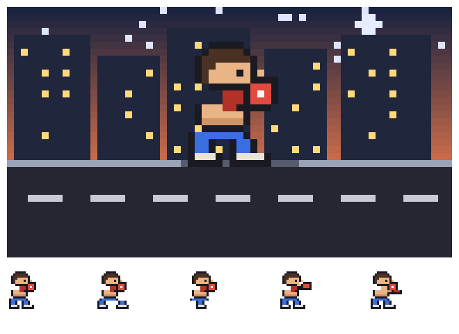

# MouseDistanceHUD

一个桌面悬浮 HUD：统计你的鼠标移动距离，并让一个像素拳击手在街道上跟着你训练。



- **鼠标移动** → 距离累计（自动切 cm / m / km），拳击手开始奔跑，楼房与路面按视差向左卷动；拳击手始终朝右，不随鼠标换向
- **敲键盘** → 拳击手出一拳（左右手交替），`punches` 计数 +1
- **停止操作 350 ms** → 回到抱架待机

窗口 336×72，无边框、透明背景、始终置顶。按住画面可拖动窗口，右上角「Reset」归零、「×」退出。

## 环境要求

| 依赖 | 说明 |
| --- | --- |
| Godot 4.7 | `project.godot` 里 `config/features` 标的是 4.7，渲染后端为 GL Compatibility |
| Windows | `keyhook.exe` 用的是 Win32 低级键盘钩子（`WH_KEYBOARD_LL`），仅 Windows 可用 |
| .NET Framework 4.x | 只有重新编译 `keyhook.exe` 时才需要，Windows 自带 `csc.exe` |

## 快速开始

```bat
git clone https://github.com/suntectec/MouseDistanceHUD.git
cd MouseDistanceHUD
build-keyhook.bat
```

然后用 Godot 打开本目录运行，或直接双击 `run.bat`。

`run.bat` 按以下顺序查找 Godot 可执行文件：

1. `GODOT_EXE` 环境变量
2. 同目录下的 `godot_path.txt`（可选，已被 `.gitignore` 忽略）
3. 脚本里记录的默认路径（可自行修改或删除）
4. `PATH` 里的 `godot`

## 项目结构

| 路径 | 说明 |
| --- | --- |
| `project.godot` | 项目配置：336×72 透明无边框置顶窗口，主场景为 `scenes/hud.tscn` |
| `scenes/hud.tscn` | 主场景，唯一节点挂载 `scripts/hud.gd` |
| `scenes/preview.tscn` | 美术预览工具：上半屏 10× 街道场景，下半屏 3× 的 5 个姿态帧 |
| `scripts/hud.gd` | HUD 主逻辑：累计距离、状态机选帧、视差卷动、窗口拖动、DPI 换算 |
| `scripts/boxer_art.gd` | 像素美术数据与程序化生成（调色板、各姿态帧、天空/楼房/路面） |
| `scripts/preview.gd` | 美术预览窗口 |
| `keyhook.cs` | Win32 全局键盘钩子助手源码（编译产物不提交） |
| `run.bat` | 启动脚本 |
| `build-keyhook.bat` | 编译 `keyhook.exe` |
| `frames_preview.png`、`boxer_scene_preview.png` | 美术预览截图（文档用） |

## keyhook.exe 是怎么工作的

Godot 拿不到「全局键盘敲击」事件（窗口没有焦点时），所以 punch 计数靠一个独立的小助手：

1. `keyhook.cs` 用 `SetWindowsHookEx(WH_KEYBOARD_LL)` 注册全局低级键盘钩子，只监听**按键抬起**（长按自动重复只算一次）
2. 每次敲击向 `127.0.0.1:<端口>` 发 1 字节 UDP 包 —— **不采集、不上报任何按键内容**
3. `hud.gd` 启动时向系统申请一个空闲端口（`bind(0)`）收包，每收到一个包就出一拳
4. 启动时把端口和 HUD 自己的 PID 一起传给助手，HUD 退出后助手自动跟随退出

exe 名在 `hud.gd` 顶部的 `HOOK_EXE` 常量里；端口不写死，由系统分配后经命令行参数传给助手——固定端口会撞上 Windows 的保留区间（`netsh int ipv4 show excludedportrange protocol=udp`），撞上时 punch 计数会静默失效。`keyhook.exe` 不存在时 HUD 照常运行，只是 punch 计数不可用。

手工编译：

```bat
csc /nologo /target:winexe /out:keyhook.exe keyhook.cs
```

## 美术说明

美术**不是**图片资源，而是 `boxer_art.gd` 里的 ASCII 像素图 + 程序化生成：

- 拳击手每帧 16×18，用调色板字符（`k` 描边、`s` 皮肤、`g` 拳套……）写成字符串数组
- 场景高 36、街道线在 y=22；楼房层和路面层各 128 宽、左右无缝，运行时叠 3 块做视差
- 想改配色只动 `PALETTE`；想改姿势只动对应的字符数组（每行必须正好 16 个字符）

改完运行 `scenes/preview.tscn` 就能看到所有帧和场景。

## 开发提示

- **`.godot/` 不要提交** —— 导入缓存，打开项目时会自动重建，已在 `.gitignore` 里
- **`.gd.uid` 和 `.import` 要提交** —— Godot 4.4+ 靠 `.uid` 稳定引用资源，忽略它们会让别人的引用错乱
- **`keyhook.exe` 不要提交** —— 改了 `keyhook.cs` 记得重新跑 `build-keyhook.bat`，否则 exe 会静默过期。编译前先关掉 HUD：运行中的 `keyhook.exe` 会锁住输出文件，导致编译器报 CS0016
- **调试截图** —— 把 `HUD_SCREENSHOT` 环境变量设成一个 png 路径，HUD 启动后会截图并退出；用 `HUD_SCREENSHOT_DELAY` 调延迟（默认 1.5 秒）
- **改窗口尺寸** —— `SCALE`、`WIN_W`、`WIN_H` 在 `hud.gd` 顶部，改的时候记得同步 `project.godot` 里的视口尺寸

## 许可

尚未指定许可证。如需他人复用，请补充 LICENSE 文件。
